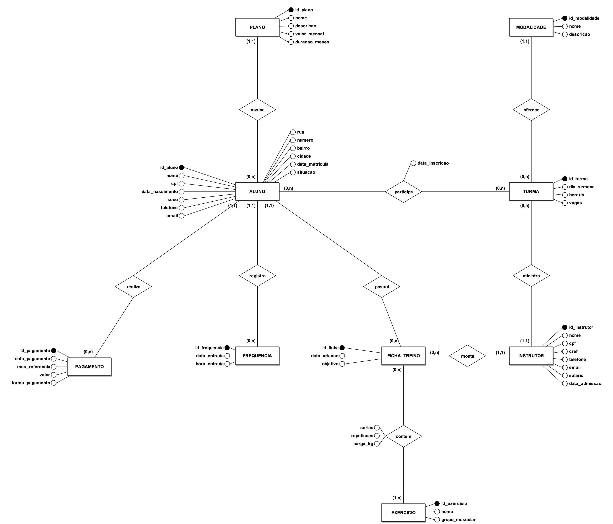
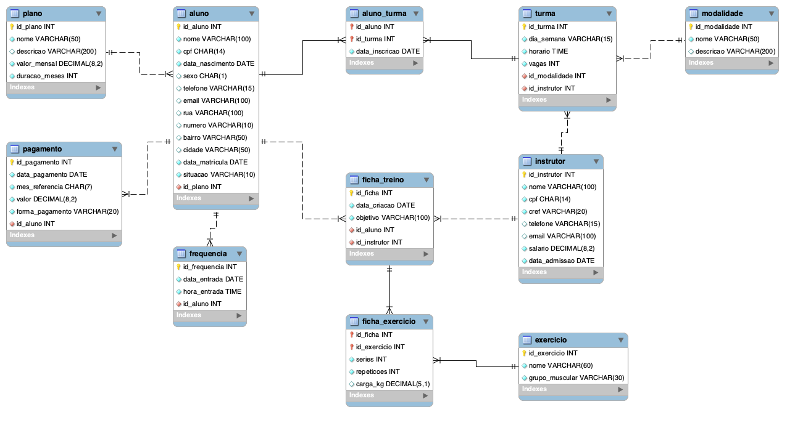

# Academia BoaForma – Projeto Final de Banco de Dados

Projeto final da disciplina **Modelagem de Banco de Dados** do curso de Ciência da Computação (semestre 2026.2),
com a Profa. MSc. Josyane Lannes Florenzano de Souza.

É um banco de dados relacional em **MySQL** para uma academia fictícia, a Academia BoaForma. Ele controla alunos,
planos, instrutores, modalidades, turmas, pagamentos, frequência na catraca e fichas de treino.

## Integrantes

- Maurício Cunha
- Adryan da Silva
- Daniel Ayan
- João Pedro Fonseca
- Gabriel dos Santos

## O que tem no projeto

| Etapa | Ferramenta | Arquivo |
|---|---|---|
| 1. Modelagem conceitual (MER) | brModelo 3.31 | `diagramas/MER_Academia_BoaForma.brM3` |
| 2. Modelagem lógica (DER) | MySQL Workbench (Data Modeling) | `diagramas/DER_Academia_BoaForma.png` |
| 3. Modelagem física (script SQL) | MySQL Workbench (SQL Development) | `sql/01_criacao_tabelas.sql` e `sql/02_insercao_dados.sql` |
| 4. Consultas SQL | MySQL | `sql/03_consultas.sql` |
| Trabalho escrito (ABNT) | Word | `documento/Projeto_Final_BD_Academia_BoaForma.pdf` |

### Modelo Entidade-Relacionamento (MER)



São 9 entidades: ALUNO, PLANO, INSTRUTOR, MODALIDADE, TURMA, PAGAMENTO, FREQUENCIA, FICHA_TREINO e EXERCICIO.
Os relacionamentos N:N *participa* (aluno–turma) e *contem* (ficha–exercício) viram tabelas associativas no modelo lógico.

### Diagrama Entidade-Relacionamento (DER)



O banco `academia_boaforma` tem 11 tabelas e 195 registros de teste.

## Consultas

O arquivo `sql/03_consultas.sql` tem 31 consultas numeradas:

- **Básicas (01 a 05):** SELECT e FROM.
- **Intermediárias (06 a 26):** DISTINCT, colunas calculadas (+, -, *, /), WHERE com operadores de comparação,
  AND/OR/NOT, SUM/AVG/MAX/MIN, COUNT, LIKE, BETWEEN, IN, ORDER BY, GROUP BY, HAVING, subconsultas, JOIN (INNER e LEFT) e UNION.
- **Avançadas:** 2 triggers e 3 stored procedures, com os testes nas consultas 27 a 31.

| Objeto | O que faz |
|---|---|
| `trg_pagamento_reativa_aluno` | Quando entra um pagamento, o aluno INATIVO volta a ficar ATIVO |
| `trg_verifica_vagas` | Não deixa inscrever aluno em turma lotada (dá o erro "Turma lotada!") |
| `sp_cadastrar_aluno` | Cadastra um aluno novo, conferindo se o CPF já existe |
| `sp_relatorio_mensal` | Mostra quanto a academia recebeu num mês, por forma de pagamento |
| `sp_alunos_pendentes` | Lista os alunos ativos que ainda não pagaram um mês |

## Como rodar

Precisa ter o **MySQL Server** e o **MySQL Workbench** instalados.

1. Ligar o MySQL (no Mac com Homebrew: `brew services start mysql`).
2. Abrir o MySQL Workbench e entrar na conexão local (**Local instance 3306**).
3. **File > Open SQL Script** > `sql/01_criacao_tabelas.sql` e executar tudo (raio ⚡ ou Ctrl+Shift+Enter).
   Ele apaga e recria o banco do zero.
4. Fazer o mesmo com `sql/02_insercao_dados.sql`.
5. Abrir `sql/03_consultas.sql` e rodar consulta por consulta (clicar nela e Ctrl+Enter / Cmd+Enter).
6. Triggers e procedures: selecionar o trecho **4.3 CONSULTAS AVANCADAS** (do primeiro `DROP TRIGGER` até o
   último `DELIMITER ;`) e executar a seleção. Depois rodar os testes das consultas 27 a 31.
   A consulta 31 dá erro **de propósito** ("Turma lotada!").
7. Para recomeçar do zero é só rodar o 01 e o 02 de novo.

Pelo terminal também funciona:

```bash
mysql -u root < sql/01_criacao_tabelas.sql
mysql -u root < sql/02_insercao_dados.sql
mysql -u root -t < sql/03_consultas.sql
```

## Abrindo os diagramas

- **MER:** baixar o brModelo no [GitHub oficial do projeto](https://github.com/chcandido/brModelo/releases)
  (precisa de Java), abrir com `java -jar brModelo.jar` e ir em **Arquivo > Abrir** >
  `diagramas/MER_Academia_BoaForma.brM3`.
- **DER:** no MySQL Workbench, **File > Import > Reverse Engineer MySQL Create Script**, escolher o
  `sql/01_criacao_tabelas.sql` e marcar **Place imported objects on a diagram**. O Workbench monta o diagrama
  a partir do script (a imagem pronta está em `diagramas/DER_Academia_BoaForma.png`).

## Observação

Todos os nomes, CPFs, telefones e e-mails dos dados de teste são inventados.
